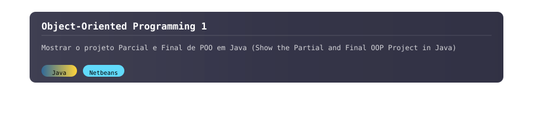

  

<!---->

---

# **`Programação Orientada a Objetos 1 (Object-Oriented Programming 1)`**

>[!IMPORTANT]
> Este repositório tem como foco principal mostrar os projetos e atividades desenvolvidos na disciplina de Programação Orientada a Objetos 1, lecionada pelo professor José Antonio Gonçalves. A linguagem utilizada em toda a disciplina foi Java.

---

>[!IMPORTANT]
> This repository primarily aims to showcase the projects and activities developed in the Object-Oriented Programming 1 course, taught by Professor José Antonio Gonçalves. The programming language used throughout the course was Java.

---

  
<strong>📂 Estrutura do Repositório (Repository Structure)</strong>

<pre>
├── OthersExercises
│   ├── Exerc_FerramCarlosGabrielBaratieri
│   │   ├── A3CarlosGabrielBaratieri.java
│   │   ├── ContLetCarlosGabrielBaratieri.java
│   │   ├── G1CarlosGabrielBaratieri.java
│   │   ├── MatrizInversaCarlosGabrielBaratieri.java
│   │   └── VetorInversoCarlosGabrielBaratieri.java
│   ├── POO_2025-2_CarlosGabrielBaratieri
│   │   ├── Calc.java
│   │   ├── Carga.java
│   │   ├── Leitura.java
│   │   ├── Motor.java
│   │   ├── Passeio.java
│   │   ├── TstVeic.java
│   │   └── Veiculo.java
│   └── TrabalhoWrappersCarlosGabrielBaratieri
│       ├── TstBool.java
│       ├── TstByte.java
│       ├── TstChar.java
│       ├── TstDoub.java
│       ├── TstFloat.java
│       ├── TstInt.java
│       ├── TstLong.java
│       ├── TstShort.java
│       └── TstWrap.java
├── ProjetoParcial
│   ├── Animacao.java
│   ├── AspectosFisicos.java
│   ├── CadastrarJosei.java
│   ├── CadastrarKodomo.java
│   ├── CadastrarMangaBase.java
│   ├── CadastrarSeinen.java
│   ├── CadastrarShoujo.java
│   ├── CadastrarShounen.java
│   ├── CodigoInvalidoException.java
│   ├── ConsultarCodigoInterno.java
│   ├── ConsultarManga.java
│   ├── ControleEstoque.java
│   ├── DiagramaUML.png
│   ├── EditorialBrasileira.java
│   ├── EditorialJaponesa.java
│   ├── EstadoConservacao.java
│   ├── Estoque.java
│   ├── EstoqueVazioException.java
│   ├── ExcluirManga.java
│   ├── Generos.java
│   ├── GeradorCIE.java
│   ├── InformacoesEditoriais.java
│   ├── InformacoesEstoque.java
│   ├── InterfaceEstoque.java
│   ├── Josei.java
│   ├── Kodomo.java
│   ├── Leitura.java
│   ├── Manga.java
│   ├── Principal.java
│   ├── Seinen.java
│   ├── Shoujo.java
│   ├── Shounen.java
│   └── Volume.java
├── ProjetoParcial-Ajustado
│   ├── Animacao.java
│   ├── AspectosFisicos.java
│   ├── AtualizarManga.java
│   ├── CadastrarMangaBase.java
│   ├── CadastroUnificadoManga.java
│   ├── CodigoInvalidoException.java
│   ├── ConsultarCodigoInterno.java
│   ├── ConsultarManga.java
│   ├── ControleEstoque.java
│   ├── EditorialBrasileira.java
│   ├── EditorialJaponesa.java
│   ├── EstadoConservacao.java
│   ├── Estoque.java
│   ├── EstoqueVazioException.java
│   ├── ExcluirManga.java
│   ├── FormatadorManga.java
│   ├── Generos.java
│   ├── GeradorCIE.java
│   ├── InformacoesEditoriais.java
│   ├── InformacoesEstoque.java
│   ├── InterfaceEstoque.java
│   ├── Josei.java
│   ├── Kodomo.java
│   ├── Leitura.java
│   ├── Manga.java
│   ├── Principal.java
│   ├── Seinen.java
│   ├── Shoujo.java
│   ├── Shounen.java
│   └── Volume.java
└── README.md
</pre>

---

>[!NOTE]
>O Projeto Parcial teve como objetivo implementar um Sistema de Estoque de Mangás para um sebo. Por se tratar de um projeto parcial, foram desenvolvidas as operações de cadastro, consulta e exclusão. O Projeto Ajustado é uma modificaçao do original para atender as correções do professor.
>Os requisitos a serem atendidos incluíam:
aplicação dos conceitos de diagrama de classes, reflexividade, encapsulamento (public e private), herança, polimorfismo (sobrecarga e sobrescrita), interface e dois tratamentos de exceção (sem multicatching). Não era permitido fazer uso de packages, interface gráfica (nessa etapa) e entre outros requisitos.

>[!NOTE]
>The Partial Project aimed to implement a Manga Stock System for a second-hand bookstore. Since it was a partial project, only the operations of registration, query, and deletion were developed. The Adjusted Project is a modification of the original to address the professor's corrections. 
>The requirements to be met included:  
>application of class diagram concepts, reflexivity, encapsulation (public and private), inheritance, polymorphism (overloading and overriding), interface, and two exception handlings (without multicatching). The use of packages, graphical interface (at this stage), and other features were not allowed.
<!--

---

## Repositório Recomendado (Recommended Repository)

  

---

  <table align="center">
    <tr>
      <td></td>
      <td></td>
    </tr>
  </table>

-->
---

  

